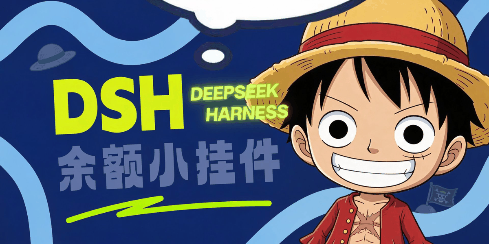

# DSH 海贼王记账挂件

[](LICENSE)




DeepSeek Harness（DSH）Web 界面右下角的常驻挂件，显示 DeepSeek 余额、今日已用和每轮对话消耗，气泡内容可自定义。挂件上的角色可以在草帽一伙 9 人中切换，并随状态改变表情。

本项目是 [MeteorNOX/DeepSeek-Balance-Whale-Widget](https://github.com/MeteorNOX/DeepSeek-Balance-Whale-Widget) 的二次开发。记账、泡泡、音效、吸附等功能来自上游，改动集中在角色皮肤和视觉主题，明细见[与上游项目的关系](#与上游项目的关系)。

## 功能

- 余额与今日已用：60 秒自动刷新，点击角色立即刷新
- 每轮消耗：按模型真实用量换算金额，每轮结束弹出气泡
- 峰谷定价：工作日高峰/空闲时段与倒计时，周末全天谷价
- 泡泡系统：点击序列、模块化排版、图片与随机语句
- 音效：按压、每轮消耗、提问、授权四组事件，音量与开关独立可调
- 拖拽吸附：四边吸附区可自定义，贴左时整体镜像

上游的完整功能（多厂商余额接口、凭据安全边界、账本口径等）见[上游 README](https://github.com/MeteorNOX/DeepSeek-Balance-Whale-Widget#readme)。

## 安装

```bash
# 从本仓库安装
dsh plugin --profile web add github:SorenLorn/dsh-onepiece-balance-widget

# 或在仓库根目录本地链接
dsh plugin --profile web add link:.
```

安装后重启 `dsh web`。宿主侧代码与图标只在启动时读取；只改前端脚本 `assets/whale-widget.js` 时，刷新页面即可。

npm 上的 `dsh-whale-widget` 是上游鲸鱼版。本仓库没有单独发版，`package.json` 的 `name` 沿用上游以避免 bundle 解析冲突，安装请用上面的 `github:` 或 `link:` 方式。

桌面客户端（Electron）使用 `desktop` profile，安装时不要加 `--profile web`，在桌面端会话里执行安装命令即可。

## 角色与状态

菜单中「形象」一行是角色切换按钮，点击后立即生效，选择保存在 `localStorage` 的 `dshw-pack`。按钮一排放不下，该行可横向滚动，滚动条位于按钮下方，也支持鼠标滚轮横向推动。重新打开菜单时，当前角色会自动滚入可视区域。

| 包 id | 角色 | idle | tap | wait | warning |
|---|---|---|---|---|---|
| `luffy` | 路飞 | 有 | 有 | 有 | 有 |
| `chopper` | 乔巴 | 有 | 有 | 有 | 有 |
| `zoro` | 索隆 | 有 | 有 | 有 | 无 |
| `nami` | 娜美 | 有 | 有 | 有 | 无 |
| `usopp` | 乌索普 | 有 | 有 | 有 | 无 |
| `sanji` | 山治 | 有 | 有 | 有 | 无 |
| `robin` | 罗宾 | 有 | 有 | 有 | 无 |
| `jinbe` | 甚平 | 有 | 有 | 有 | 无 |
| `brook` | 布鲁克 | 有 | 有 | 有 | 无 |

状态帧决定表情，CSS 动作叠加在帧上负责位移与形变：

| 场景 | 状态帧 | 动作 | 音效 |
|---|---|---|---|
| 静置 | `idle` | 4.2 秒呼吸 | 无 |
| 点击角色或泡泡 | `tap` | 挤压回弹 | `tap` |
| 松手 | 当前帧 | 落地缓冲 | `land` |
| 拖拽超过 3px | 当前帧 | 小幅摆动 | 无 |
| 每轮对话结算 | 当前帧 | 起跳 | `cost` |
| 模型思考中 | `wait` | 慢速点头 | 无 |
| 提问或授权挂起 | `wait` | 循环摇晃 | `wait` |
| 余额低于预警线 | `warning` | 抖动 | 无 |

没有 `warning` 帧的角色在告警时使用 `idle`，不会出错也不会显示碎图。切换角色只影响外观，账本、今日已用和泡泡配置都保持不变。

## 目录结构

```text
.
├── package.json              插件元数据
├── cordis.patch.yml          挂载声明
├── icon.png                  插件列表图标，256×256
├── assets/
│   ├── banner.png            README 宣传图
│   ├── whale-widget.js       前端挂件本体
│   ├── packs/                角色包，每个目录含 pack.json、状态帧、sfx/、emblem.svg
│   └── ...                   默认形象、内置音效、泡泡图
├── lib/
│   ├── index.js              宿主插件：路由、记账、角色包扫描
│   └── accounting.mjs        记账内核
└── tools/
    ├── prep-art.py           素材处理
    ├── make-sfx.mjs          音效合成
    └── ci-audit.mjs          CI 自检
```

宿主注册 28 个 `/dsh-whale/*` 路由，全部经过 DSH 的浏览器信任栅栏。未带会话直接访问返回 401 或 403，说明路由已注册。

## 素材处理

角色帧由原始立绘经 `tools/prep-art.py` 生成。原始立绘不入库，只在本地作为输入，仓库里保留处理后的 `assets/packs/**`。

```bash
python tools/prep-art.py            # 处理全部角色
python tools/prep-art.py nami       # 处理单个角色
python tools/prep-art.py --check    # 只输出白边与光晕指标，不写文件
```

脚本按以下顺序处理：

1. 去底色。只删除与画布边缘连通的白底，角色内部的白（眼白、牙齿、白衣、帽子上的图案）保持不透明。这些区域与被包住的背景空隙在亮度、标准差、面积上互相重叠，自动判断会误删角色部件，需要删除的封闭空隙在脚本的 `HOLES` 中按坐标指定。
2. 去白边。轮廓外侧 1~2 像素是角色色与白底的混色，用内侧颜色覆盖；半透明边缘带用最近的角色色填充；模糊产生的低 alpha 过渡裁剪到 1 像素。
3. 归一化与曝光。统一缩放到 1024×1024，角色高度占 88%，同一角色包内的各帧按彩色像素亮度对齐。

新增角色时，在 `JOBS` 中按 `(包 id, 原图, 输出帧, 擦除矩形, 是否已抠图)` 增加三行即可，缺失的 `pack.json`、`emblem.svg` 和音效会自动补齐。

## 与上游项目的关系

| 能力 | 上游 | 本仓库 |
|---|---|---|
| 记账、余额观测、泡泡、音效、吸附、路由、打包 | 实现 | 沿用，未改动 |
| 角色形象 | 单张鲸鱼图 | 9 套角色包，每套 3 至 4 张状态帧 |
| 角色切换 | 上传图片或使用内置形象 | 菜单分段按钮，选择写入 `localStorage` |
| 素材处理 | 无 | `tools/prep-art.py` |
| 视觉 | 鲸鱼主题 | 海贼王主题的图标、宣传图与气泡配色 |

上游作者为月匠（MeteorNOX），本项目遵循上游的 MIT 许可。

## 常见问题

**切换角色后记账数据会变吗？**

不会。角色只影响显示，账本按密钥指纹分本存储，与皮肤无关。

**换了图标为什么没有生效？**

`icon.png` 在宿主启动时读取，需要重启 `dsh web` 或桌面客户端。

**余额和官网对不上怎么办？**

先确认是同一账户、同一币种、同一统计区间。有充值记录时，在「小鲸鱼记账 → 余额校正」中填写实际到账金额。统计口径见上游 README。

**怎么改气泡内容？**

菜单中的「泡泡设置」可以逐模块编辑，金额用 `{cost}` 引用。

## 参与

新增角色包、素材处理改进与问题反馈的流程见 [CONTRIBUTING.md](CONTRIBUTING.md)。

## 许可证

代码使用 MIT 许可，见 [LICENSE](LICENSE)。

`assets/` 与 `icon.png` 中的美术素材不在 MIT 覆盖范围内，按原样随插件分发，不授予再许可。角色立绘由 AI 图像工具生成，属于同人演绎，不是官方素材。来源与权利说明见 [PROVENANCE.md](PROVENANCE.md)。

## 致谢

- [MeteorNOX/DeepSeek-Balance-Whale-Widget](https://github.com/MeteorNOX/DeepSeek-Balance-Whale-Widget)：上游项目与本项目的基础，作者月匠（MeteorNOX）及全部贡献者，名单见上游 README。
- 上游的 Codex 端口维护在 [Codex-Whale-Public](https://github.com/Yang-huai406/Codex-Whale-Public)，与本仓库无关。
